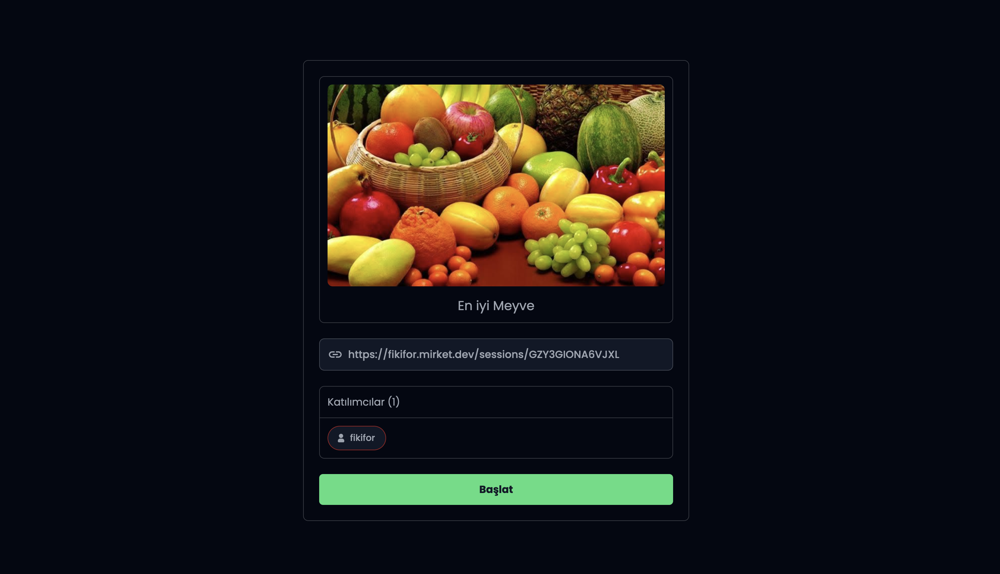
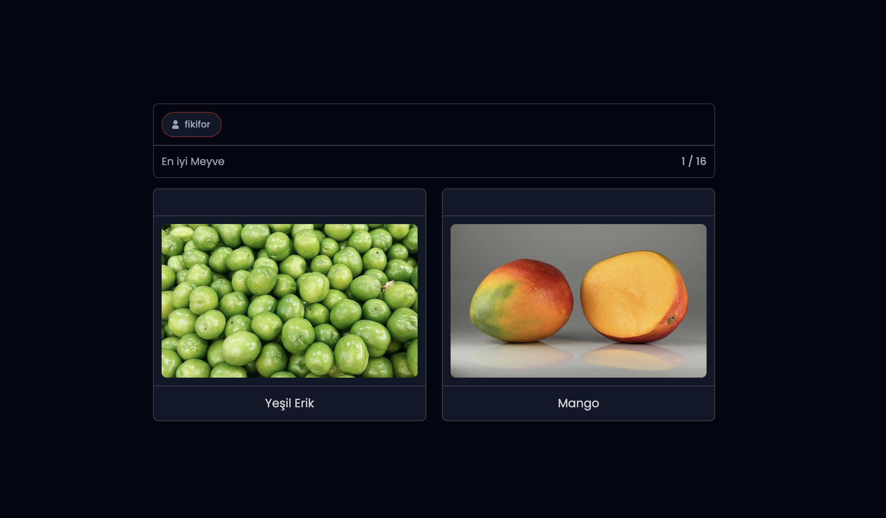

# Fikifor 🎮

<div align="center">
  

  **A real-time multiplayer quiz tournament game**
</div>

Fikifor lets players join live elimination tournaments, vote on paired quiz
items, and continue through successive rounds until one item wins.

## Monorepo structure

```text
fikifor/
├── apps/
│   ├── api/                 # Express, Socket.IO, Prisma, and uploaded files
│   └── web/                 # Nuxt 3 single-page application
├── packages/
│   └── contracts/           # Shared API schemas, domain types, and socket events
├── deploy/                  # Production Compose contract and environment template
├── public/                  # Repository documentation assets
├── docker-compose.yml       # Local full-stack Compose environment
├── package.json             # Root workspace commands
├── pnpm-lock.yaml           # Single dependency lockfile
└── pnpm-workspace.yaml      # Workspace package discovery
```

The API and Socket.IO server share one package and container image, but run as
separate Node processes. Podman owns process lifecycle, restart policy, health
checks, and log rotation.

## Technology

- Nuxt 3, Vue, Nuxt UI, Tailwind CSS, and Pinia
- Express, Socket.IO, TypeScript, Zod, and Prisma
- PostgreSQL and Redis
- pnpm workspaces
- Podman and podman-compose

## Requirements

- Node.js 20+
- pnpm 10.33+
- PostgreSQL 14+ for host-based development
- Podman 6+ with podman-compose for the containerized workflow

## Full stack with Podman

The shortest path to a running local installation is:

```bash
corepack enable
pnpm podman:up
```

Compose builds both application images, starts PostgreSQL and Redis, applies
Prisma migrations, and then starts the API, Socket.IO, and web containers.

- Web: http://localhost:3000
- API health: http://localhost:3001/health
- Socket health: http://localhost:3002/health

Follow logs or stop the stack with:

```bash
pnpm podman:logs
pnpm podman:down
```

The default credentials and JWT secret are intended only for local use. Use the
production environment template under `deploy/` for an actual deployment.

## Host-based development

Install all workspace dependencies once from the repository root:

```bash
corepack enable
pnpm install
cp apps/api/.env.example apps/api/.env
```

Start PostgreSQL and Redis through Podman and apply migrations:

```bash
podman compose up -d postgres redis
pnpm db:deploy
```

The local Compose PostgreSQL port is `5433` to avoid colliding with a common
host installation on port `5432`. Redis binds to `6380`.

Run each long-lived process in its own terminal:

```bash
pnpm dev:api
pnpm dev:socket
pnpm dev:web
```

The web application defaults to the local API and socket URLs. Nuxt runtime
values can be overridden with `NUXT_PUBLIC_APP_URL`,
`NUXT_PUBLIC_API_URL`, and `NUXT_PUBLIC_SOCKET_URL`.

## Root commands

| Command | Purpose |
| --- | --- |
| `pnpm build` | Build every workspace application |
| `pnpm lint` | Lint and verify formatting with zero warnings |
| `pnpm typecheck` | Type-check every workspace package |
| `pnpm test` | Run contract, HTTP, socket, security, and tournament tests |
| `pnpm db:build` | Rebuild the composed Prisma schema and client |
| `pnpm db:migrate` | Create or apply development migrations |
| `pnpm db:deploy` | Apply committed migrations |
| `pnpm podman:up` | Build and start the local full stack |
| `pnpm podman:down` | Stop the local stack |

## Database workflow

Prisma model fragments live in `apps/api/prisma/schemas/`.
`pnpm db:build` combines them with `apps/api/prisma/config.prisma`, writes
`apps/api/prisma/schema.prisma`, and generates the Prisma client.

Commit every production schema change as a migration:

```bash
pnpm db:build
pnpm db:migrate -- --name describe_the_change
```

Podman startup runs `prisma migrate deploy` in a one-shot migration container
before either backend service starts.

Votes are committed under a PostgreSQL session-level advisory lock. Match
completion, persisted winner selection, and next-round creation therefore
happen exactly once even when final votes arrive simultaneously or multiple
socket instances are running. Socket.IO uses Redis for cross-instance rooms and
multi-tab presence.

## Quality and security

- REST and Socket.IO payloads share Zod schemas from `packages/contracts`.
- Authentication has expiring JWTs, rate limits, explicit CORS origins, and
  hardened HTTP headers.
- Uploaded and linked images have type, size, pixel, timeout, redirect, and
  private-network protections.
- API and socket processes expose liveness and dependency-aware readiness
  endpoints and shut down gracefully on `SIGTERM`.
- `.github/workflows/ci.yml` runs migrations, lint, type checks, tests, builds,
  and both Docker image builds.

## Production deployment

See [deploy/README.md](./deploy/README.md) for image build, configuration,
reverse-proxy, migration, persistent-volume, and upgrade instructions.

Production uses direct Node processes inside containers; Podman owns their
lifecycle and restart behavior.

## Screenshots

<div align="center">
  
  
</div>
