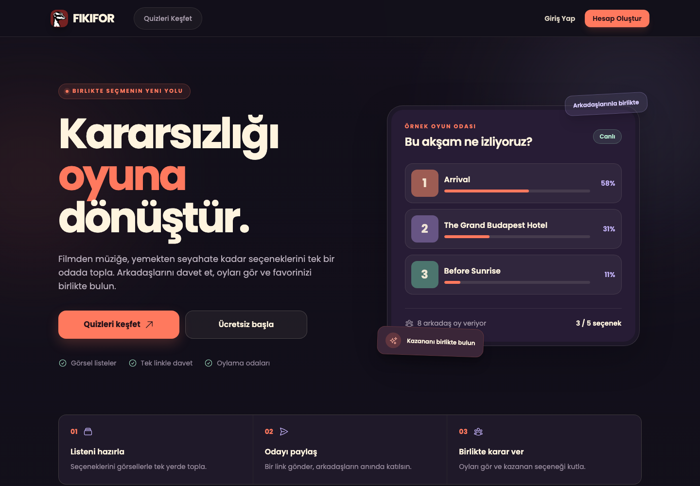

# Fikifor

**Turn a group decision into a live elimination tournament.**

Create a visual list, invite friends to a room, and vote on pairs of items until
one favorite remains. Fikifor brings real-time voting to choices such as films,
music, food, and travel. The current interface is in Turkish.

[Open Fikifor](https://fikifor.mirket.dev/) · [Local setup](#run-locally) · [Deployment](deploy/README.md) · [Report an issue](https://github.com/nazmirket/fikifor/issues)

[](https://fikifor.mirket.dev/)

## Features

- **Visual lists:** create quizzes with images and discover public lists.
- **Shared rooms:** invite participants with a session link or code.
- **Live voting:** follow votes and progress together through elimination rounds.
- **Persistent results:** store quizzes, sessions, and outcomes in PostgreSQL.
- **Real-time coordination:** Socket.IO and Redis support room events and presence.

## Run locally

Use **Node.js 24**, **pnpm 10.33.0**, and **Podman with a Compose provider**.
Start the Podman machine first on macOS or Windows.

```sh
git clone https://github.com/nazmirket/fikifor.git
cd fikifor
corepack enable
pnpm podman:up
```

Compose builds the application images, starts PostgreSQL and Redis, applies
committed migrations, and starts the API, socket server, and web app.

| Service       | Local address                |
| ------------- | ---------------------------- |
| Web app       | http://localhost:3000        |
| API health    | http://localhost:3001/health |
| Socket health | http://localhost:3002/health |

```sh
pnpm podman:logs
pnpm podman:down
```

The default credentials and JWT secret are for local development. Configure
production credentials and a TLS reverse proxy using the
[deployment guide](deploy/README.md).

## Develop on the host

From the repository root, install dependencies and create the API environment:

```sh
pnpm install --frozen-lockfile
cp apps/api/.env.example apps/api/.env
podman compose up -d postgres redis
pnpm db:build
pnpm db:deploy
```

Wait for PostgreSQL to become healthy before applying migrations. The example
environment uses PostgreSQL on port `5433` and Redis on `6380`, matching Compose.
Set a local `JWT_SECRET` in `apps/api/.env` before starting the API.

Run each process in its own terminal:

```sh
pnpm dev:api
pnpm dev:socket
pnpm dev:web
```

The web app's public runtime configuration can be overridden with
`NUXT_PUBLIC_APP_URL`, `NUXT_PUBLIC_API_URL`, and `NUXT_PUBLIC_SOCKET_URL`.

Leaderboard entries expose their normalized result as `scorePercentage`. Clients
must use that field; the deprecated `share` response alias has been removed.

## Project structure

| Path                  | Responsibility                                               |
| --------------------- | ------------------------------------------------------------ |
| `apps/web/`           | Nuxt, Vue, Nuxt UI, Tailwind CSS, and Pinia web application  |
| `apps/api/`           | Express API, Socket.IO server, Prisma models, and uploads    |
| `packages/contracts/` | Shared Zod schemas, domain types, and socket events          |
| `deploy/`             | Production Compose configuration and deployment instructions |
| `docker-compose.yml`  | Local full-stack environment                                 |

The API and socket server use the same package and image, running as separate
Node processes. PostgreSQL stores durable state; Redis coordinates live rooms.
The pnpm workspace uses one root dependency lockfile.

## Verify changes

```sh
pnpm lint
pnpm typecheck
pnpm test
pnpm build
```

Database integration tests require a **disposable, migrated test database** and
`TEST_DATABASE_URL`; socket tests also require Redis. Without that variable,
database integration suites are skipped. See
[the CI workflow](.github/workflows/ci.yml) for the complete test environment.

For complete local verification with disposable PostgreSQL and Redis, start
Podman, install Chromium, and run:

```sh
pnpm exec playwright install chromium
pnpm verify:isolated
```

This applies migrations, runs tests and builds, then exercises the browser journey.
It allocates its own containers and loopback ports and removes its containers and
volumes afterward. It does not reuse development servers. For manually provisioned
tests, set `TEST_DATABASE_URL` to a local disposable database ending in `_test` and
set `REDIS_URL` explicitly; browser fixtures and servers use that same database.
A test database name is a guardrail, not proof that a database is disposable.

CI runs lint, type checks, tests, builds, browser tests, and API/migration/web
container builds. Validate Compose changes with `podman compose config --quiet`.

## Database changes

Model fragments live in `apps/api/prisma/schemas/`. `pnpm db:build` combines them
with `prisma/config.prisma` and generates the Prisma client.

```sh
pnpm db:build
pnpm db:migrate -- --name describe_the_change
```

Commit schema changes with their migrations. Use `pnpm db:deploy` to apply
committed migrations; the Compose migration service runs this step before the
backend starts. For existing databases and production backups, follow the
[deployment guide](deploy/README.md).

## Contributing

Use [GitHub Issues](https://github.com/nazmirket/fikifor/issues) for reproducible
bugs and focused feature proposals. Include the steps, expected behavior, and
relevant environment details when reporting a problem.

For agent-assisted development, [AGENTS.md](AGENTS.md) documents the Mirket
workflow for Codex Desktop and Claude Desktop Code. Run `pnpm agents:check`
alongside the applicable application checks. After installation changes or a
task/memory failure, run `pnpm agents:runtime` for local registration readiness
and invoke `runtime_status` in each actual desktop connection. These checks
cover different boundaries; CI success alone does not establish live adoption.

Release provenance, per-client activation and troubleshooting are described in
[the harness guide](docs/harness.md).
